# Alber 导演台 · Alber H3 Director Console

**一个节点，一条时间轴，一集带原生声音的片。**

MiniMax H3 多段导演台，把「模型加载 → 分镜编排 → 分段采样 → 段间衔接 → 解码拼接 → MP4 落地」全部收进一个节点。
在 AIMixer 的 `ComfyUI_MiniMaxH3_Director`（Apache-2.0）之上重构：内置加载器、单节点成型、Pika 双 LoRA 一键切换，
并补齐了分镜自动化、提示词模板库、成片预览列、二采放大与浅色主题。

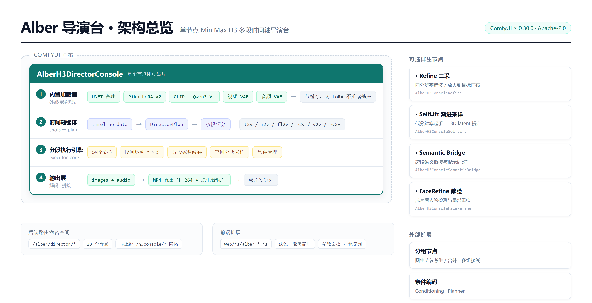


> **English TL;DR** — A single-node timeline director for MiniMax H3 inside ComfyUI.
> It packs built-in UNET/LoRA/CLIP/VAE loading, multi-segment timeline editing, cross-segment motion context,
> per-segment disk caching, direct MP4 export with native audio, plus optional refine / self-lift / face-refine
> companion nodes. Derived from AIMixer's `ComfyUI_MiniMaxH3_Director` under Apache-2.0.

---

## 目录

- [它解决什么问题](#它解决什么问题)
- [亮点](#亮点)
- [界面速览](#界面速览)
- [快速开始](#快速开始)
- [核心概念](#核心概念)
- [执行链路](#执行链路)
- [功能详解](#功能详解)
- [节点与端口](#节点与端口)
- [参数速查](#参数速查)
- [HTTP 路由](#http-路由)
- [性能与显存](#性能与显存)
- [二采：放大与补细节](#二采放大与补细节)
- [常见问题](#常见问题)
- [目录结构](#目录结构)
- [许可与致谢](#许可与致谢)

---

## 它解决什么问题

原生 H3 工作流是一条长长的节点链：UNETLoader、LoraLoader、CLIPLoader、两个 VAE、采样器、解码、VideoCombine……
想改一个镜头的提示词，要在图上找半天；想出 12 个镜头的连续短片，得手工复制 12 套节点再拼起来。

这个插件把这条链折叠成一个节点，并且把「多镜头」当成一等公民：

| 原生做法 | 这里 |
|---|---|
| 一条提示词出一段，镜头之间各玩各的 | 一条时间轴切 N 段，逐段独立采样，段间用运动上下文衔接 |
| 改一镜要重跑整条 | 分段磁盘缓存，改哪段只重跑哪段 |
| 手动接 VideoCombine / VHS 才能出片 | 内置 MP4 直出，带 H3 原生音轨 |
| 分镜要另外写 | 贴一段剧本直接拆成镜头表，或按模板库拼提示词 |
| 参数散在节点上，节点高到一千多像素 | 折叠参数面板 + 右侧独立成片预览列 |

**适合**：短剧 / 广告 / 概念片这类「多镜头 + 要声音 + 要能反复改某几个镜头」的活。
**不适合**：单张图出一段就完事的随手实验 —— 用原生节点更轻。

---

## 亮点

- **单节点成型** — 不接任何上游节点也能出片；接了外部模型则以外部为准，可以插 Sage Attention 之类的补丁。
- **六种任务共用一条时间轴** — `t2v / i2v / fl2v / r2v / v2v / rv2v`，按镜头自由切换。
- **段间运动上下文** — 上一段尾部的 AV 潜变量作为永不参与去噪的条件接进下一段，动作与声音顺势延续。
- **分段缓存** — 帧数据无损存 FFV1，改一镜只重跑一镜。
- **Pika 双 LoRA 一键切换** — 同一个 hybrid 基座，切 ref2va / fl2va 时自动带上对应的 6 步蒸馏调度。
- **按段挂 LoRA** — 每个镜头最多 8 个 LoRA，各段独立、互不串味；带 VBVR 运动一致性快捷开关（一键 0.7）。
- **分镜自动化** — 剧本拆镜头、批量出首尾帧、按官方模板扩写提示词，三件套都在面板里。
- **提示词模板库** — 12 类 221 条（景别 / 运镜 / 角度 / 光线 / 构图 / 动作 / 表情 / 场景 / 氛围 / 时段 / 声音 / 成句），可搜索、可跨镜头插入。
- **内置 MP4 直出** — H.264 + 原生音轨，路径、文件名、CRF 可控，目录写错自动回退不丢片。
- **成片预览列** — 节点右侧按分辨率自适应宽度的播放器，出片即载入、可拖进度、一键开目录。
- **二采放大** — 成片落盘后再过一遍 Topaz Proteus，补回毛发与织物细节；不参与采样、不抢 H3 显存，跑完在右侧并排挂一列放大预览做对比。选片不限于当前成片，任一 mp4 都能拉进来。
- **浅色主题** — 白底节点 UI，覆盖层实现，删一个 CSS 文件即回退深色。
- **可与上游原版共存** — 独立节点 ID、独立路由命名空间，装在一起互不抢占；旧工作流自动迁移。

---

## 界面速览

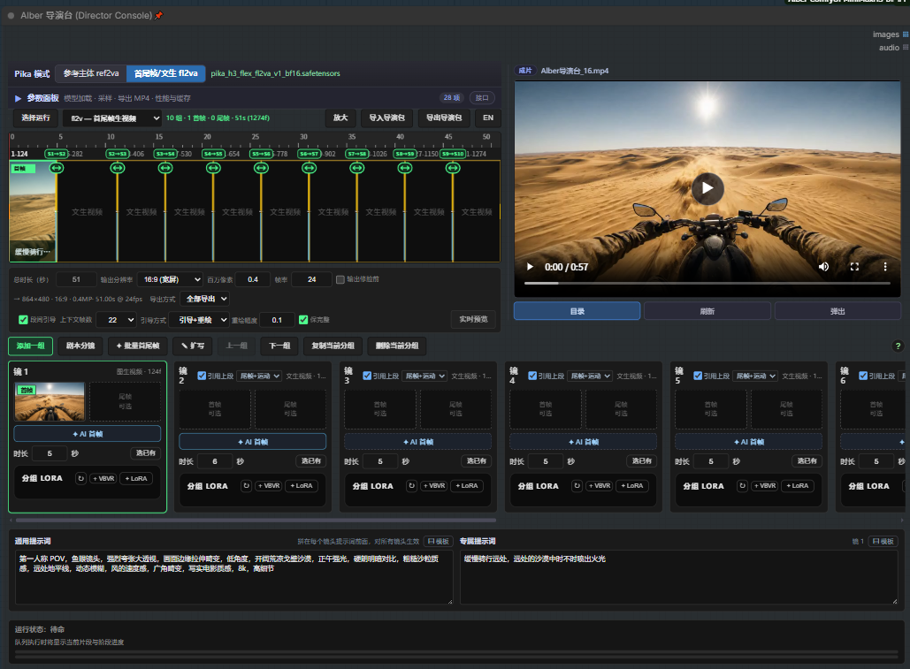

*一条时间轴切成 8 段（每段顶部标出帧号区间），右侧是跟着分辨率自适应的成片预览列，下方是逐镜分镜卡。*

一个节点就是一间剪辑房，从上到下依次是：

| 区域 | 里面有什么 |
|---|---|
| **Pika 切换条** | `参考主体 ref2va` / `首尾帧文生 fl2va` 一键切，右侧显示当前 LoRA 文件名 |
| **参数面板** | 默认收起，展开是「模型加载 / 采样 / 导出 MP4 / 性能与缓存」四组卡片，28 项 |
| **时间轴** | 段与段的切分、帧号区间、首帧是否就位、段间 pin 标记；右键可增删分组、改衔接方式 |
| **分镜卡** | 逐镜的首尾帧槽位、`✦ AI 首帧`、时长、**分组 LoRA**、引用上一段粒度 |
| **预览列** | 出片即载入的播放器，`目录 / 刷新 / 弹出 / ✦ 二采` 四个动作；二采跑完在它右边再挂一列放大预览 |
| **底部** | 全片通用的提示词 + 当前镜头的专属提示词，两个框各带 `▤ 模板` 按钮 |

后面每一节对应上面的一块，想直接跑起来可以跳到 [快速开始](#快速开始)。

---

## 快速开始

### 1. 环境要求

| 项 | 要求 |
|---|---|
| ComfyUI | ≥ 0.30.0（需要官方 MiniMax H3 节点） |
| Python | ≥ 3.10 |
| 显存 | **16 GB 可跑**（864×480 逐段串行）；24 GB 更从容 |
| 磁盘 | 模型约 40 GB 起；分段缓存另计（FFV1 约为原始帧的 1/3） |

### 2. 安装

```bash
cp -r "Alber-ComfyUI-MiniMaxH3-Director" "<ComfyUI>/custom_nodes/"
pip install -r "<ComfyUI>/custom_nodes/Alber-ComfyUI-MiniMaxH3-Director/requirements.txt"
```

重启 ComfyUI → 菜单 `MiniMaxH3` → **Alber 导演台 (Director Console)**。搜 `alber` 或 `导演台` 也能找到。

> 因为用的是独立类型 ID（`AlberH3DirectorConsole` / `AlberH3Console*`），
> 装在已有原版 Director / Console 的机器上**不需要停用任何东西**。

### 3. 放模型

下拉列表走 ComfyUI 的 `folder_paths`，放好即可（支持 `extra_model_paths.yaml` 映射）：

| 用途 | 目录 | 默认文件 |
|---|---|---|
| UNET 基座 | `models/diffusion_models` | `minimax_h3_hybrid_fl2va_ref2va_b25-49-int8.safetensors` |
| LoRA | `models/loras` | `pika_h3_flex_ref2va_v1_bf16.safetensors` |
| 文本编码 | `models/text_encoders` | `qwen3vl_32b_minimax_h3_nvfp4_awq.safetensors` |
| 视频 VAE | `models/vae` | `minimax_h3_video_vae_fp16.safetensors` |
| 音频 VAE | `models/vae` | `minimax_h3_audio_vae_fp32.safetensors` |

默认值只是参考配置；换成你自己有的权重即可，下拉里会列全。

### 4. 出第一段

节点默认是一个 **T2V 空项目**：无参考图、无预置提示词、124 帧 / 24 fps / 864×480。
在分镜卡片里写提示词 → 队列。跑完 MP4 会落在 `ComfyUI/output/`，右侧预览列自动载入。

---

## 核心概念

### 时间轴与段

一条时间轴由若干**镜头（shot）**组成，每个镜头是一次独立采样，长度按秒给，帧数自动对齐。
采样是一段一段串行跑的，段与段之间的衔接靠下面的机制。

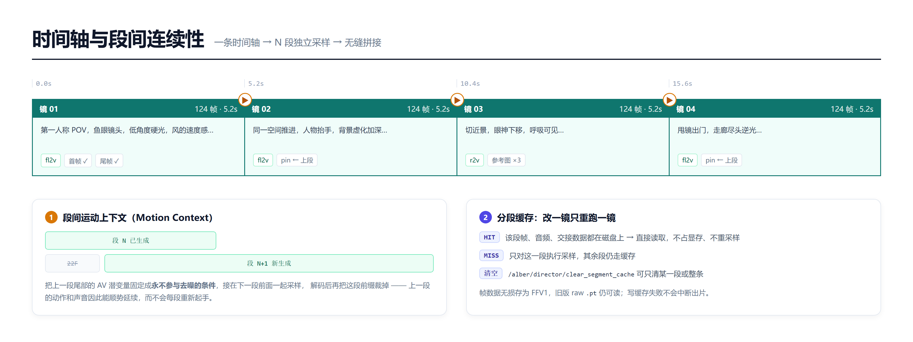

### 段间运动上下文（Motion Context）

上一段解码后的 AV 尾部（默认 22 帧）会作为**永不参与去噪的条件**接到下一段前面一起采样，
解码后把这段前缀裁掉。效果是：动作、镜头运动、环境声能顺势延续，而不是每段都重新起手。

关掉它，每段就是完全独立的生成 —— 需要硬切时反而更好。

具体到每一段，「引用上一段」有三档粒度，在时间轴或分镜卡上**右键**就能改，不用进参数：

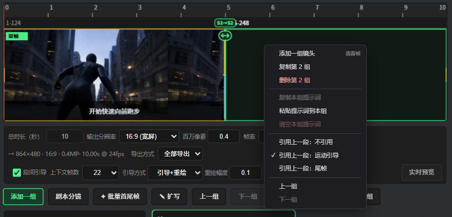

| 档位 | 实际行为 | 什么时候用 |
|---|---|---|
| **不引用** | 本段完全独立起手，硬切 | 换场面、换时间、故意要断开 |
| **运动引导**（默认） | 上一段末帧做本段开头，同时注入运动条件 | 连续动作、跟拍、对话正反打 |
| **尾帧** | 只把上一段末帧当本段首帧，从那一帧接着画，不做运动引导 | 只要画面接得上、不希望被上段运动带偏 |

前置条件是总开关 **段间引导**（时间轴下方）要开着；第 1 段没有上段，这三项是灰的。
同一个菜单里还有「添加一组镜头 / 复制第 N 组 / 删除第 N 组 / 复制本组提示词 / 粘贴 / 清空」，都是针对当前段的。

### 分段缓存

每段跑完会把帧、音频、交接数据写到 `output/minimax_seg_cache/<名字>_<节点id>/`：

- 帧存**无损 FFV1**，体积约为 raw 的 1/3；旧版 raw `.pt` 仍可读，下次写入时替换
- 命中缓存 → 跳过采样 / 解码 / 写入三个阶段，只读磁盘
- 改一镜只重跑那一镜，其余段不动
- 写缓存失败（只读盘、重名、磁盘满）**不会中断出片**

清理：`/alber/director/clear_segment_cache`，可只清某一段或整条。

### 六种任务类型

| task_type | 输入 | 说明 |
|---|---|---|
| `t2v` | 提示词 | 纯文生视频 |
| `i2v` | 首帧图 | 单图起手 |
| `fl2v` | 首帧 + 尾帧 | 首尾帧控向，可只给尾帧 |
| `r2v` | 参考图 ×1–9 | 参考主体 / 风格 |
| `v2v` | 参考视频 ×1–3 | 视频参考 |
| `rv2v` | 参考图 + 参考视频 | 混合参考 |

---

## 执行链路

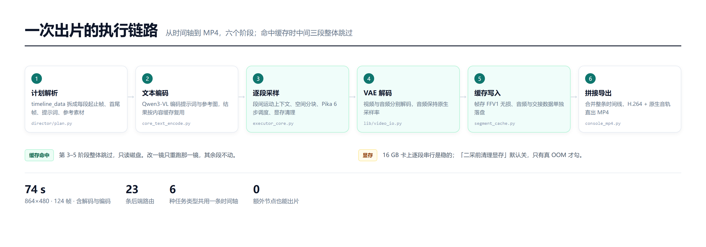

六个阶段，命中缓存时中间三段（采样 / 解码 / 写入）整体跳过。
执行逻辑都在 `director/`，节点层只是薄包装（`nodes/director_console.py`）。

---

## 功能详解

### 单节点成型

主节点内置 UNET / LoRA / CLIP / 两个 VAE 的加载器。同时 `model`、`clip`、`video_vae`、`audio_vae`
四个输入是**可选**的：

- 不接线 → 用节点顶部的内置加载器（最省事）
- 接线 → **以外部为准**。例如 `UNETLoader → Sage Attention Patch → LoraLoader → 导演台.model`，
  这样既能挂加速补丁，又能继续用内置的 CLIP / VAE

内置加载器带缓存：切换 ref2va ↔ fl2va 不会重读多 GB 的基座权重，只重新应用 LoRA。

### Pika 双 LoRA 一键切换

同一个 hybrid 基座，靠 LoRA 决定走哪条路，**任务模式必须配套**：

| LoRA | 适用 task_type |
|---|---|
| `pika_h3_flex_fl2va_v1_bf16` | `t2v` / `i2v` / `fl2v` |
| `pika_h3_flex_ref2va_v1_bf16` | `r2v` / `v2v` / `rv2v` |

节点面板顶部有一条切换条：

```
Pika 模式  [参考主体 ref2va] [首尾帧/文生 fl2va]   pika_h3_flex_fl2va_v1_bf16.safetensors
```

点任意一侧会直接改本节点的 `lora_name`，并**自动同步 `task_type`**；右侧显示当前 LoRA 文件名。
两个 Pika LoRA 也被顶到下拉列表最前面。找不到文件时红字提示，不静默失败。

#### Pika 调度：默认 6 步，不是 25 步

Pika H3 Flex 是把 H3 的 50 步生成器**蒸馏到 6 步**的 LoRA，按固定 sigma 计划训练：

| 项 | 正确值 |
|---|---|
| sigmas（ManualSigmas） | `1.0 / 0.972973 / 0.923077 / 0.8 / 0.571429 / 0.333333 / 0`（**0–1 值域**，7 个值 = 6 步） |
| 采样器 | `lcm` |
| CFG | `1.0` |
| LoRA 强度 | `1.0` |
| shift | video 12 / audio 3 |

> ⚠️ **不要写成 `1000 / 750 / 500 / …`**。H3 是 flow matching，sigma 值域是 0–1；
> 传 1000 级的值会让 DiT 的 timestep 反演整个错位，第一步就发散成 NaN —— 采样器不报错、
> 帧数音轨全正常，成片却是纯黑 mp4（NaN→uint8 静默变 0）。`core_sampling` 里已加兜底：
> 检测到 sigma 最大值 > 10 会告警并自动 ÷1000 换算。

节点上的 **`Pika 调度`** 控件三档：`自动（按 LoRA）`（默认）/ `强制 Pika 6 步` / `关闭（用步数/调度器）`。
接上 `sigmas` 输入口时以你的 sigmas 为准。

用通用采样器跑 25 步不仅慢约 4 倍，还偏离蒸馏计划，画质并不会更好。

### 分组 LoRA（按段挂 / VBVR 一键）

导演台的 `lora_name` 是**整条时间轴共用的基座 LoRA**；分镜卡里的「分组 LoRA」是另一个维度 ——
**每个镜头自己的 LoRA 栈**。

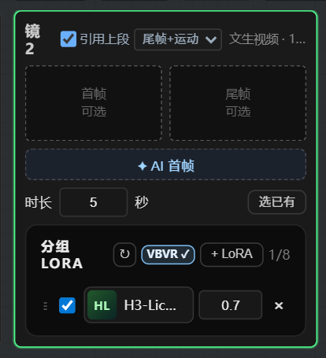

- 每段最多 **8 个**，行内可勾选启用、改强度（-10 ~ 10）、拖动排序、`×` 删除
- 有预览图的显示缩略图，没有的显示文件名首字母块
- 采样前对**本段基座 MODEL 的 clone** 打补丁再采样（`ModelPatcher.clone() + add_patches`），
  不挂 LoRA 的段仍用导演台 `model` 输入原样采样 —— 段与段之间不会串味
- 整条时间轴依旧是**一次运行**，段间引导（`引用上一段`）照常跨段生效

#### VBVR：运动一致性一键开关

「分组 LoRA」旁边那个 `+ VBVR` 按钮，点一下就给当前段挂上
`H3-Licon-VBVR-I2V`，强度 **0.7**：

| 状态 | 样子 | 点击行为 |
|---|---|---|
| 未挂 | `+ VBVR` | 挂上，变成普通 LoRA 行（强度可以再手改） |
| 已挂 | `VBVR ✓`（蓝底高亮） | 连整行移除 |
| 文件不在 | 置灰、加不了 | 但**已挂的仍可移除**，否则历史工程里那条就删不掉了 |

文件名按 `/vbvr/i` 模糊匹配，换子目录、改名、以后出 v2 都还认得。
三个入口共用同一套逻辑：时间轴分段面板、fl2v 分镜卡、图片批量卡。

挂上以后整条时间轴长这样（镜 2 挂 VBVR，其余段不挂，互不影响）：

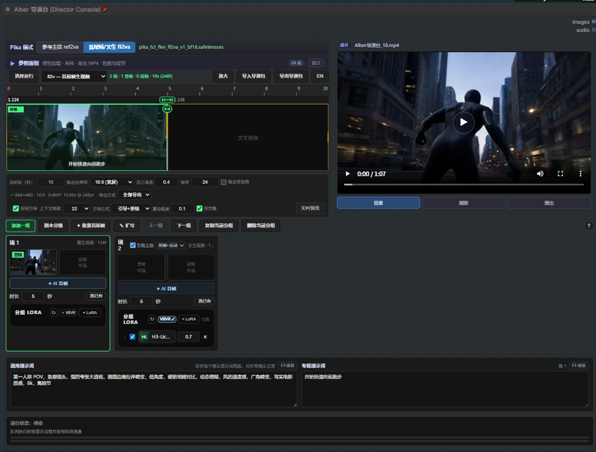

**它治什么**：物体分身、穿模、动作顺序错乱（放下杯子又跳回手里这类）。
**它不治**画质、表情、口型。训练时 `audio_loss_weight = 0`、`supervised_audio_fraction = 0`，
音频分支一点没动 —— 挂上后声音仍是 H3 原样输出。

> 用法建议：只给「手拿道具 / 两人肢体接触 / 人物穿过家具 / 多个同类物体同框」的镜头挂，
> 纯对话特写不挂。作者没做强度消融，1.0 是唯一验证过的点，从 **0.7** 起试更稳。

### 参数面板（可折叠）

二十多个下拉原本在节点上纵向排一长串，节点高度轻松破千。现在全部收进 Pika 条下面的折叠框：

```
▶ 参数面板   模型加载 · 采样 · 导出 MP4 · 性能与缓存          28 项   接口
```

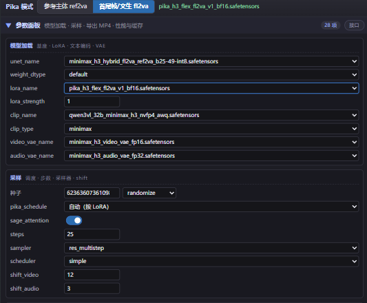

*展开后是「模型加载」和「采样」两张卡片（下面还有导出 MP4 / 性能与缓存），两列网格排布。*

- **默认收起**，只占一行；展开状态记在 `properties.alberParamBoxOpen`，跟着工作流走
- 收起时节点高度按内容收缩，把画布还给你
- 框内按 **模型加载 / 采样 / 导出 MP4 / 性能与缓存** 四组卡片排布，两列网格（节点窄了自动单列）
- 值双向同步：框里改 = 改节点控件

实现方式不是删控件：canvas 控件仍留在 `node.widgets` 里，只是 `computeSize` 归零、`draw` 置空（隐身），
所以**序列化、API 提交、旧工作流兼容完全不变**，框里用的是原生 DOM 控件。

### 分镜自动化

首尾帧模式的工具栏上多了三个入口；镜头卡右键还有一整排针对本组的操作：

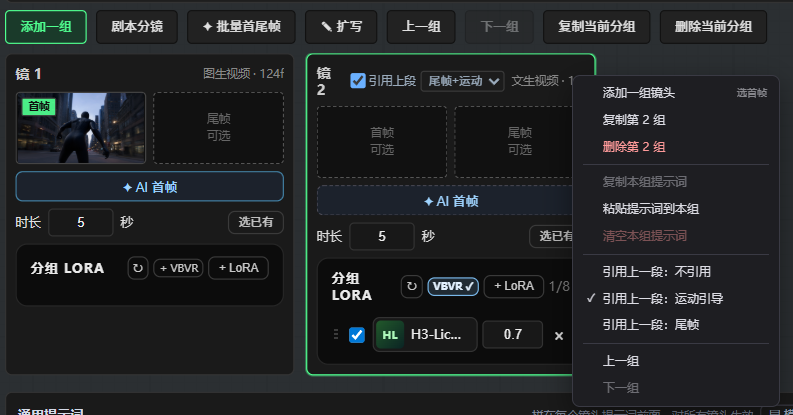

*`添加一组 / 剧本分镜 / ✦ 批量首尾帧 / ✎ 扩写 / 上一组 / 下一组 / 复制当前分组 / 删除当前分组`；卡片右键管首尾帧槽位、本组提示词与「引用上一段」。*

| 按钮 | 干什么 | 依赖 |
|---|---|---|
| **剧本分镜** | 贴一段剧本 → 拆成镜头表（每镜：运动提示词 + 首帧画面提示词 + 时长），确认后可**追加**或**替换**时间轴 | 面板自带模型配置（服务 / 地址 / 模型 / Key，记住上次填的，可「拉模型」列出本机已有模型）；模型没开时用**本地快拆**，不依赖网络 |
| **✦ 批量首尾帧** | 给整条时间轴串行出首帧 / 尾帧，出完自动回填槽位 | 本机 Qwen-Image 2.1，走 ComfyUI 队列，不需要额外装东西 |
| **✎ 扩写** | 按 MiniMax H3 官方 task 模板扩写提示词，单条或批量，中英文输出 | 需要 LLM（Ollama / 智谱 / OpenAI 兼容） |

#### 剧本 → 分镜表

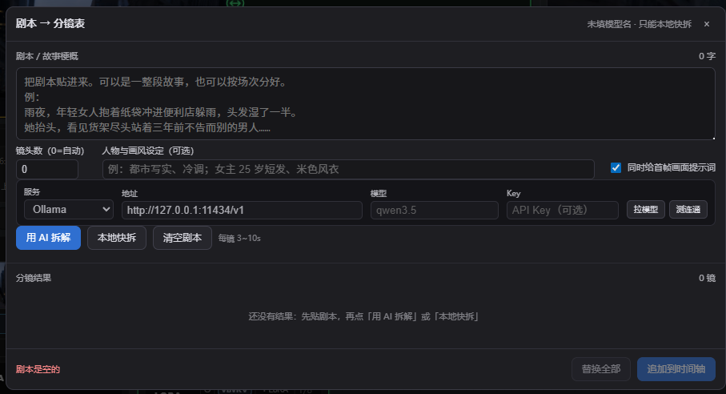

*上方贴剧本，中间可选填人物与画面设定（一起交给模型），右侧定每镜时长范围；底部是结果与「替换全部 / 追加到时间轴」。*

- **用 AI 拆解**：贴剧本 → 返回镜头表 → 逐条改 → 追加或替换
- **本地快拆**：不联网。按空行 + 句末标点切句，字数 ÷ 4.5 估秒数并夹在 3~10 s，先出骨架再手改
- 首帧提示词直接存进 `shot.framePrompt`，随 `timeline_data` 一起序列化，**刷新不丢**
- 模型配置与「提示词扩写」共用一份（`localStorage["alber.llm.config"]`），填一次两边都有；
  「拉模型」列出本机已加载的模型，「测连通」发一次最小请求验通

#### 批量首尾帧

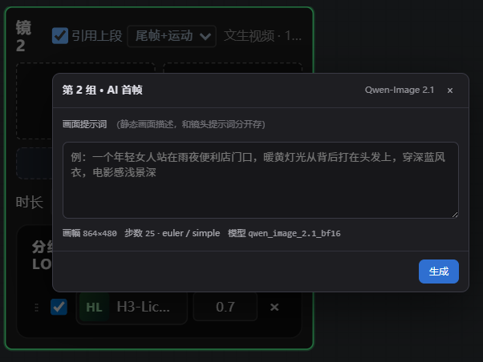

*单镜出图就是卡上的 `✦ AI 首帧`；批量入口在工具栏，出完统一回填槽位。*

- 每行一张镜头卡，画面提示词可逐条改；**「只补空槽」默认勾上**，已有图不会被覆盖
- 目标槽可选 首帧 / 尾帧 / 首尾都出；尾帧会自动接一句收尾后缀，否则首尾两张会是一模一样的图
- **一次只提交一张**（16G 显存最稳），带进度条和「停止」；停止时会把队列里那张也撤掉
- 结果先回填槽位，全部跑完统一 commit 一次

### 提示词扩写（独立面板）

| 能力 | 说明 |
|---|---|
| 模板 | `default / t2v / i2v / fl2v / r2v / v2v / rv2v` 七种，默认跟随节点当前任务类型；可「查看模板」改，改了就按 `custom_template` 发出 |
| 单条 | 左写原句（可「取当前镜头」「取通用」），右出结果，可直接改，一键写回 |
| 批量 | 一次扩写整条时间轴，逐镜串行；**结果先列出不动时间轴**，确认后「全部应用」才写回 |
| 多语言 | 中文（简体）/ English —— 官方示例与 T5 系统提示词是英文，选英文通常更贴官方效果 |
| 角色特征增强 | 让模型写 ≥300 汉字的详尽人物外观，适合 `r2v` / `rv2v` |
| 带参考图 | 勾上会把当前镜头的首帧 / 尾帧一起发给模型，**只有 vision 模型有效**，默认不勾 |

模型配置与「剧本分镜」共用一份（`localStorage["alber.llm.config"]`），填一次两边都有。
节点上没有 `llm_*` 输入，所以配置不能存在节点里。

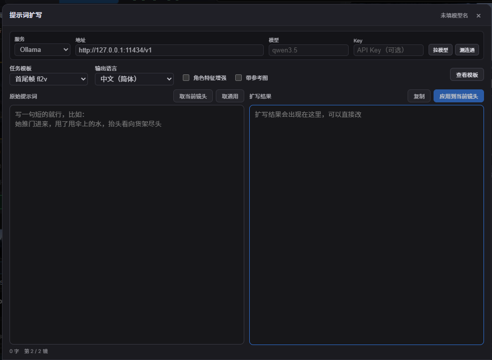

*顶部一行是模型配置；左边写原句（可「取当前镜头」「取通用」），右边出结果，可以直接改再写回。*

fl2v / i2v 的镜头会把首尾帧的包裹句剥掉只留画面描述，不会把「首帧：……」这种结构再扩写一遍。

### 提示词模板库

两个提示词输入框（通用 / 专属）右上角各有一个 **▤ 模板** 按钮，弹出可搜索的分类模板列表：

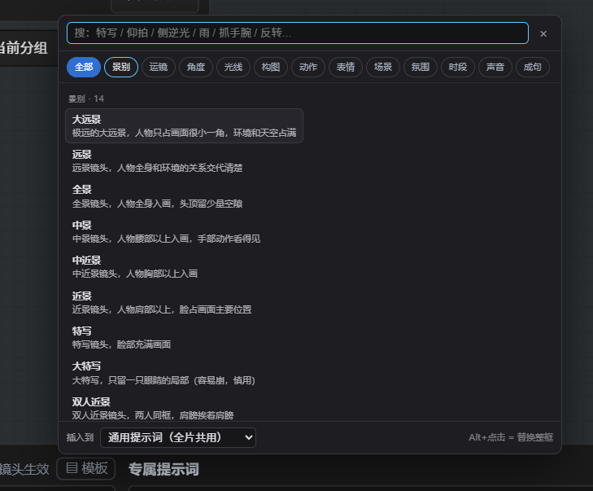

*搜索框支持中文名、正文、英文术语混搜；上面一排是 12 个分类；底部「插入到」可以指定插进哪一镜。*

| 分类 | 条数 | 举例 |
|---|---|---|
| 景别 | 14 | 大远景 / 中景 / 近景 / 特写 / 过肩 / 主观视角 / 空镜 |
| 运镜 | 24 | 固定机位 / 缓推 / 急推 / 跟拍 / 环绕 / 手持 / 希区柯克变焦 |
| 角度 | 15 | 平视 / 仰拍 / 俯拍 / 鸟瞰 / 荷兰角 / 贴地机位 / 门缝视角 |
| 光线 | 22 | 侧逆光 / 逆光剪影 / 硬光 / 烛光 / 霓虹 / 黄金时刻 / 高反差暗调 |
| 构图 | 14 | 三分法 / 框架构图 / 前景遮挡 / 浅景深 / 大面积留白 |
| 动作 | 30 | 推门进来 / 转身就走 / 抓手腕 / 摔手机 / 握紧拳头 / 背过身 |
| 表情 | 24 | 隐忍 / 冷笑 / 震惊 / 委屈 / 心死 / 眼神躲闪 / 苦笑 |
| 场景 | 24 | 便利店门口 / 老居民楼楼道 / 医院走廊 / 出租车后座 / 雨里的窄巷 |
| 氛围 | 16 | 电影感 / 胶片颗粒 / 冷色调 / 复古 DV / 潮湿发霉 |
| 时段 | 12 | 清晨 / 黄昏 / 深夜 / 大雨 / 起雾 / 刮风 |
| 声音 | 14 | 雨打车窗 / 电流嗡鸣 / 心跳声 / 脚步回响 / 一片寂静 |
| 成句 | 12 | 情绪爆点 / 反转揭示 / 压迫感 / 亲密拉扯 / 首帧画面句 |

- **搜索**：中文名、正文、英文术语（`close-up`、`dolly in`、`golden hour`）都能命中；多关键词空格分隔（`特写 雨`）
- **插入**：单击 = 插到光标处（自动补逗号，可连续点选拼句子）；**Alt / ⌥ + 单击 = 替换整框**
- **选镜头**：底部「插入到」可指定插进哪一镜，不用先切过去；也可选「通用提示词」写全片共用部分
- 键盘：`↑` `↓` 选、`Enter` 插入、`Esc` 关闭
- 主面板（文生视频 / 混合 / 分段）的提示词框也有同一按钮，只插入到它自己

模板按 H3 的用法写：动作类只写「怎么动」不堆静态描写，声音类只写「现场能听到什么」（H3 自己生成原生声音），
成句类里的 `〔主体〕` `〔景别〕` 是占位符，插进去再改。

### 内置 MP4 直出

节点底部五个控件（追加在最后，不影响旧工作流控件索引），在参数框的「导出 MP4」组里：

| 控件 | 默认 | 说明 |
|---|---|---|
| **导出 MP4** | ✅ 开 | 跑完直接写 H.264 MP4（带 H3 原生音轨） |
| **MP4 保存目录** | 空 | 空 = `ComfyUI/output`；相对路径 = `output` 下子目录；绝对路径 = 直接写那里 |
| **MP4 文件名** | `Alber导演台` | 只写名字即可；带 `/` 时前半段仍作子目录 |
| **MP4 画质 CRF** | `18` | libx264，越小越清晰，成片建议 16–20 |
| **覆盖同名 MP4** | ⬜ 关 | 关：重名自动加 `_2` / `_3`；开：直接覆盖（播放器占用时会回退到下一个可用名） |

- 文件名不带 `_00001_`：`牙膏从中间挤.mp4`，重名才加 `_2`
- 目录不可写（盘符不存在、权限不够）时**自动回退到 `output/`**，不会因为路径写错丢片
- 多段导出时先把 `images`、`audio` 拼成整条时间线，再编码成**一个** mp4
- 编码失败只记日志、返回空 `mp4_path`，**不会中断出片**
- 节点已标记为 `OUTPUT_NODE`，画布上只留这一个节点就会执行并落片；想继续用 VHS / SaveVideo 也行，两条路并存

#### 导出参数自愈（老工作流）

`widgets_values` 是按「保存当时的控件顺序」存的数组。老工作流加载到新版本节点时可能整体错位，
导出这组会拿到 `True` / `"性能"` 这种不相干的值 —— 曾经真的产出过 `output/性能/False.mp4`。现在的处理：

- 加载时 `sanitizeExportWidgets()` 兜底：`mp4_prefix` 非字符串或 `true/false/none` → 回默认名；
  `mp4_crf` 非 1–51 → 回 18；`mp4_dir` 等于标题条文字（"性能"/"采样设置"/"高级采样"）→ 清空
- 文本框只在用户真敲过字时才提交（`dirty` 标记），避免把显示用的 `"false"` 写回控件
- 后端 `_clean_name()` / CRF 校验再兜一层，非法值只 warn 并回默认

**根治办法**：在参数框里确认一次导出设置后重新保存工作流，`widgets_values` 会按新顺序重新生成。

### 成片预览列

预览不放在参数框里，而是**节点右侧独立的一列**：

- **与时间轴等高**：`top/bottom: 6px` 贴住 host 上下边，不随参数框展开收起变高
- **宽度按分辨率算**：列宽 = 可用高度 × (w ÷ h)，夹在节点宽度 46% 以内。竖屏出窄列、横屏出宽列，画面不留黑边；改分辨率会立刻重算
- 实现是给 `.mmx-host` 加 `padding-right`，预览列绝对定位在 padding 区 —— 不动 host 的 DOM 结构，时间轴布局一行没改
- 首次挂载会把节点**自动补宽一次**，记在 `properties.alberPreviewWidened`

| 元素 | 行为 |
|---|---|
| 文件名行 | 显示 `名字 · 大小 · 帧数`，点击复制完整路径 |
| 预览区 | 出片后自动载入，可拖进度条 |
| 打开目录 | 资源管理器定位到最后一条片 |
| 刷新 | 文件被删 / 移走时提示「找不到」，不会一直放旧画面 |
| 新窗口 | 浏览器原生播放器打开，可全屏 |

路径记在 `node.properties.alberMp4Path`，跟着工作流走。

### 伴生节点：Refine / SelfLift / Semantic Bridge / FaceRefine

主节点不接它们也能出片，接上则多一道工序：

**Refine 二采** — 三种模式：

| mode | 行为 |
|---|---|
| `refine` | 同分辨率二采（精修） |
| `upscale` | 先放大到目标画布再二采；`upscale_method` 选 `h3_latent` / `lanczos` / `nvidia_rtx_vsr` |
| `latent_upscale` | 只放大 H3 latent，不再二采 |

`h3_latent` 需要把 H3 的 3D latent 放大权重放到 `models/latent_upscale_models/`
（如 `minimax_h3_latent_upscaler_3d_*.safetensors`）。
`nvidia_rtx_vsr` 需要 `pip install nvidia-vfx`（仅 NVIDIA RTX 显卡）。
另有两个默认关闭的开关：**二采前清理显存**、**脸修前清理显存** —— 24 GB 或出现 OOM 时才勾，勾了每段多一次加载。

**SelfLift 渐进采样** — 低分辨率起手，再用 3D latent lift 提升到目标分辨率继续采，省一部分算力。

**Semantic Bridge** — 跨段语义衔接：把上一段的内容摘要写进下一段的条件里，适合长镜头段落。

**FaceRefine 修脸** — 成片后人脸检测 → 裁剪 → 局部重绘 → 拼回。需要把 `face_yolov8m.pt`（或同类）
放到 `models/ultralytics/bbox/`。

### 浅色主题

节点整块 UI 是浅色的（白底、深字、绿色强调），跟 ComfyUI 深色画布形成对比。三部分组成，**都不改原类名和 DOM 结构**：

| 文件 | 作用 |
|---|---|
| `web/js/alber_light_theme.css` | 覆盖层样式：300+ 条规则，把深色面板 / 按钮 / 输入框改成浅色 |
| `web/js/alber_light_theme.js` | 注入 CSS + 设置节点外框配色 |
| `minimax_timeline.js`、`minimax_fl2v.js` | 画在 canvas 上的部分（标尺、轨道底色、缩略图占位）改浅色常量 |

覆盖层全部带 `.mmx-host` 前缀 + `!important`，压得住原来的深色规则，也不影响别的节点。
**删掉 `alber_light_theme.css` 就退回深色**，原样式一行没动。

那份 CSS 不是手写的，是 `_tools/gen_light_theme.py` 从现有深色样式机械推导的
（暗面 → 近白并保留明暗层次、暗色文字 → 深色文字、强调色保留色相只调明度），最后补一段手写层次微调。
改了上游深色样式后重跑一次即可同步：

```bash
python _tools/gen_light_theme.py     # 重新生成 web/js/alber_light_theme.css
python _tools/preview_light_theme.py # 生成离线预览页，用浏览器看效果
```

---

## 节点与端口

| 节点 | 类型 ID | 说明 |
|---|---|---|
| **Alber 导演台 (Director Console)** | `AlberH3DirectorConsole` | **主节点**，内置加载器，单节点出片 |
| Alber 导演台 · Refine | `AlberH3ConsoleRefine` | 二采 / 放大 |
| Alber 导演台 · SelfLift | `AlberH3ConsoleSelfLift` | 渐进一采 |
| Alber 导演台 · Semantic Bridge | `AlberH3ConsoleSemanticBridge` | 语义桥 |
| Alber 导演台 · FaceRefine | `AlberH3ConsoleFaceRefine` | 修脸 |
| Alber 导演台 · Conditioning | `AlberH3ConsoleConditioning` | 条件编码 |
| Alber 导演台 · Planner Conditioning | `AlberH3ConsolePlannerConditioning` | 计划条件编码 |
| Alber 导演台 · 分组（图生视频） | `AlberH3ConsoleGroupImageToVideo` | 外部多组接线 |
| Alber 导演台 · 分组（参考生视频） | `AlberH3ConsoleGroupReferenceToVideo` | 外部多组接线 |
| Alber 导演台 · 合并分组 | `AlberH3ConsoleGroupsCombine` | 多组合并 |

**主节点输出**：`images`、`audio`、`fps`、`frame_count`、`source_images`、`report`、
`images_pre_refine`、`images_pre_face_refine`、`mp4_path`。

---

## 参数速查

### 模型加载

| 控件 | 默认 | 说明 |
|---|---|---|
| `unet_name` | `minimax_h3_hybrid_fl2va_ref2va_b25-49-int8` | H3 基座，仅在内置加载时使用 |
| `weight_dtype` | `default` | int8 hybrid 基座用 default；fp8 省显存 |
| `lora_name` | `pika_h3_flex_ref2va_v1_bf16` | 选 `None` 关闭；两个 Pika LoRA 置顶 |
| `lora_strength` | `1.0` | 纯 T2V 时设 0 或选 None |
| `clip_name` / `clip_type` | Qwen3-VL / `minimax` | 类型固定 |
| `video_vae_name` / `audio_vae_name` | fp16 / fp32 | 视频与音频分开 |

### 采样与导出

| 控件 | 默认 | 说明 |
|---|---|---|
| `task_type` | `t2v` | `t2v / i2v / fl2v / r2v / v2v / rv2v` |
| `Pika 调度` | 自动（按 LoRA） | 见上文 |
| `width` / `height` | 864 / 480 | 改这里预览列宽度会跟着变 |
| `fps` / 帧数 | 24 / 124 | 按镜头时长自动对齐 |
| `清除显存` 系列 | 关 | 段间 / 二采前 / 脸修前 |
| `导出 MP4` 系列 | 见上文 | 目录 / 文件名 / CRF / 覆盖 |
| `缓存存储方式` | raw | `raw` 快、占盘；`ffv1` 约 1/3 体积、多一次编解码 |
| `缓存文件夹名` | 空 | 留空 = 用节点 id |

---

## HTTP 路由

命名空间 `/alber/director/*`，与上游原版的 `/h3console/director/*` 完全隔离。

| 路由 | 作用 |
|---|---|
| `POST /enhance` | 按模板扩写提示词 |
| `GET /enhance_models` | 列出可用 LLM 模型 |
| `GET /get_template` | 取官方 task 模板全文 |
| `POST /script_to_shots` | 剧本 → 镜头表 |
| `GET /image_b64` | 取镜头参考图的 base64 |
| `GET /mp4_preview` | 按绝对路径回放 mp4（FileResponse + Range） |
| `GET /mp4_info` | 文件是否存在 / 大小 / 修改时间 |
| `GET /open_folder` | 系统文件管理器打开目录 |
| `POST /clear_segment_cache` | 清分段缓存（某一段或整条） |
| `GET /first_pass_cache_status` | 一采缓存状态 |
| `POST /unload_model` · `/unload_ollama` | 手动卸载模型 / 释放 Ollama |
| `POST /detect_shots` · `/extract_frames` | 智能分镜、抽帧 |
| `POST /probe_video` · `/list_input_media` | 探测视频、列输入素材 |
| `POST /extract_reference_audio` · `/prepare_reference_audio_chunk` | 参考音频抽取 |
| `POST /upload_chunk` | 大文件分片上传 |
| `POST /export_pack` · `/import_pack` · `/download_pack` | 工程打包 / 导入 / 下载 |
| `GET /lora_preview` · `/lora_previews` | LoRA 预览图 |
| `GET /upscale_status` · `/upscale_info` | 二采引擎自检（`?probe=1` 真跑一次）、读源视频信息 |
| `GET /fs_list` | 二采选片用的目录浏览：不给 `path` 回盘符 + 常用目录，给了回子目录与视频文件 |
| `POST /upscale_start` · `/upscale_cancel` | 起 / 停二采作业 |
| `GET /upscale_job` | 二采进度、耗时、输出路径 |

---

## 性能与显存

实测环境：RTX 5070 Ti 16 GB / i7-6700K / 64 GB，ComfyUI 同时占用 11 GB 显存的前提下测得。

| 场景 | 耗时 | 备注 |
|---|---|---|
| H3 出片 864×480 · 124 帧（约 5 秒） | **74 s** | 含 VAE 解码与 MP4 编码 |
| 同上，命中分段缓存 | 约 1–2 s | 只读磁盘 |

---

## 二采：放大与补细节

成片落盘之后再单独过一遍放大。**不参与采样、不占 H3 的显存**，因此不影响出片队列。

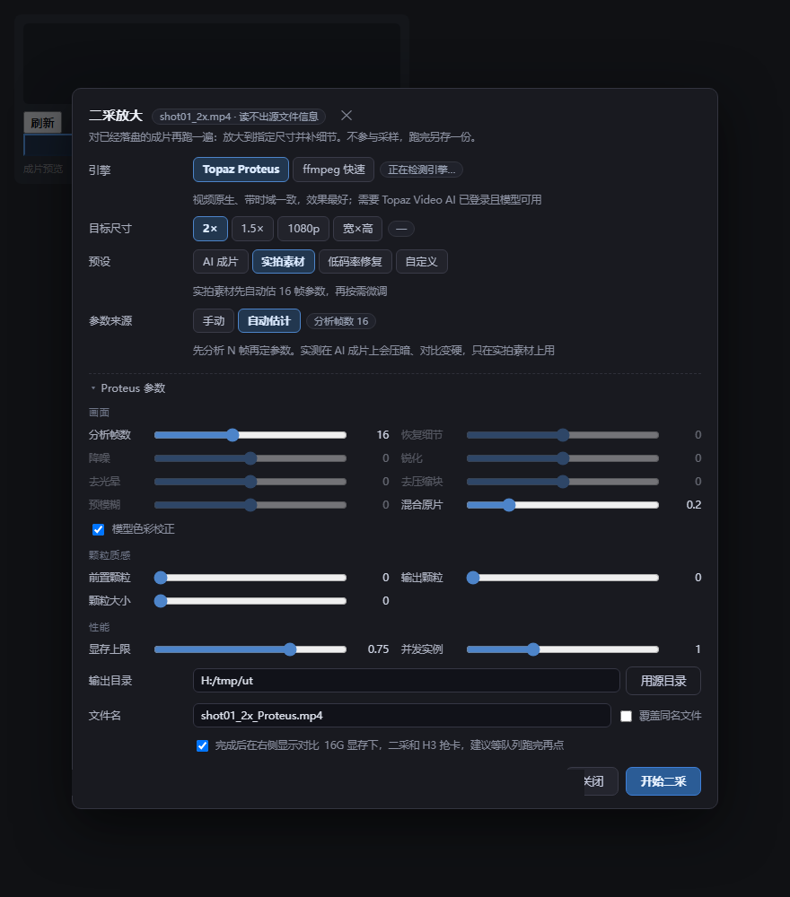

*成片预览列下方点「✦ 二采」弹出的面板：引擎、目标尺寸、四档预设、14 个参数分三组，右下角直接起作业。*

### 选片：不必是当前这一条

面板顶部有一行**源视频**，显示完整路径，右边「选择视频…」打开文件浏览器：

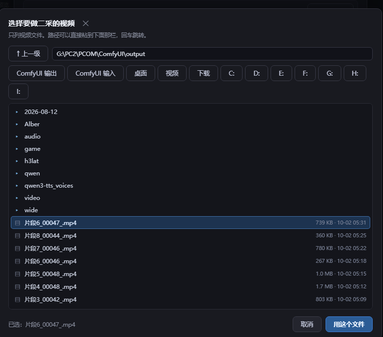

- **只列视频**（mp4 / mov / mkv / webm / m4v / avi），最新的排最前 —— 找刚出的片不用翻
- 快捷栏常驻：`ComfyUI 输出` / `ComfyUI 输入` / 桌面 / 视频 / 下载，加上本机所有盘符，
  随时切盘，不用先退回根
- 路径栏可以直接粘一个完整路径回车跳过去；贴的本身就是文件，就直接选中它
- **面板里没有当前成片也能打开**，选完再跑；换源后输出目录和文件名自动跟着变
  （前提是你没手改过它们，改过就保留）
- ComfyUI 桌面版（Electron）还能把视频文件直接拖到这一行

**为什么不做上传**：ComfyUI 和浏览器在同一台机器上，二采要的是**服务器路径**，
几百 MB 的成片在 loopback 上再搬一遍纯属浪费。所以这里是后端列目录、直接把路径填进 `src`。
远程访问 ComfyUI 时也一样 —— 列的是**服务器**的盘。

两种触发方式，走的是同一份后端实现：

- **界面**：成片预览列下方「✦ 二采」按钮 → 选引擎/尺寸/参数 → 跑完在**右侧**挂一列放大预览并排对比，可展开大窗、滚轮缩放、拖动平移。
- **命令行**：`_tools/upscale_cli.py`，预设、尺寸、14 个参数都能从命令行给。

```bash
python _tools/upscale_cli.py 成片.mp4                          # AI 成片预设 + 2×
python _tools/upscale_cli.py 成片.mp4 --preset live --mode 1080p
python _tools/upscale_cli.py 成片.mp4 --mode custom --w 2560 --h 1440
python _tools/upscale_cli.py 成片.mp4 --blend 0.3 --grain 0.02  # 单给参数会覆盖预设
python _tools/upscale_cli.py --check                            # 只查环境，不处理文件
```

### 输出与对比

面板底部四个控件决定文件落在哪、跑完怎么看：

| 控件 | 行为 |
|---|---|
| **输出目录** | 默认填成片所在目录，旁边 `用源目录` 一键拉回 |
| **文件名** | 默认 `<原文件名>_Proteus.mp4`，不覆盖源文件 |
| **覆盖同名文件** | 不勾时目标已存在会直接报错退出，不会静默覆盖 |
| **完成后在右侧显示对比** | 勾上则跑完在成片预览列右边挂**第二列**播放器 |

第二列和主预览列并排，点标题可展开成大窗，里面滚轮缩放、拖动平移，用来逐帧比原片和放大后的差别；
窗口不够宽时它自动叠到主列下方。二采作业跑在独立进程，**进度按帧上报**，取消即杀进程。

### 引擎对比（同一段素材、同样输出 1728×960）

| 方案 | 120 帧耗时 | 峰值显存 | 补真细节 | 帧间一致 |
|---|---|---|---|---|
| ffmpeg `lanczos + unsharp` | 2.4 s | 0 | ❌ | — |
| ffmpeg `hqdn3d + lanczos + CAS` | 4.2 s | 0 | ❌ 但观感最干净 | — |
| 轻量 SRVGGNet ×4 | 5.9 s | 0.16 GB | ✅ | ❌ |
| RealESRGAN ×4 → 降采 | 135–295 s | 3.2 GB | ✅ 最锐 | ❌ 逐帧独立推理 |
| **Topaz Proteus 4** | **17 s** | 独立进程 | ✅ 最自然 | ✅ 视频原生、带时域 |

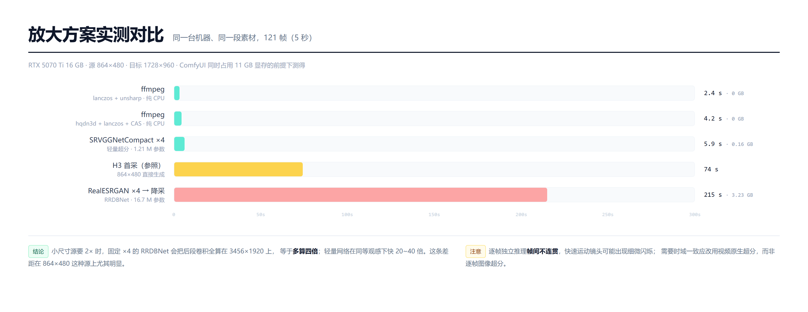

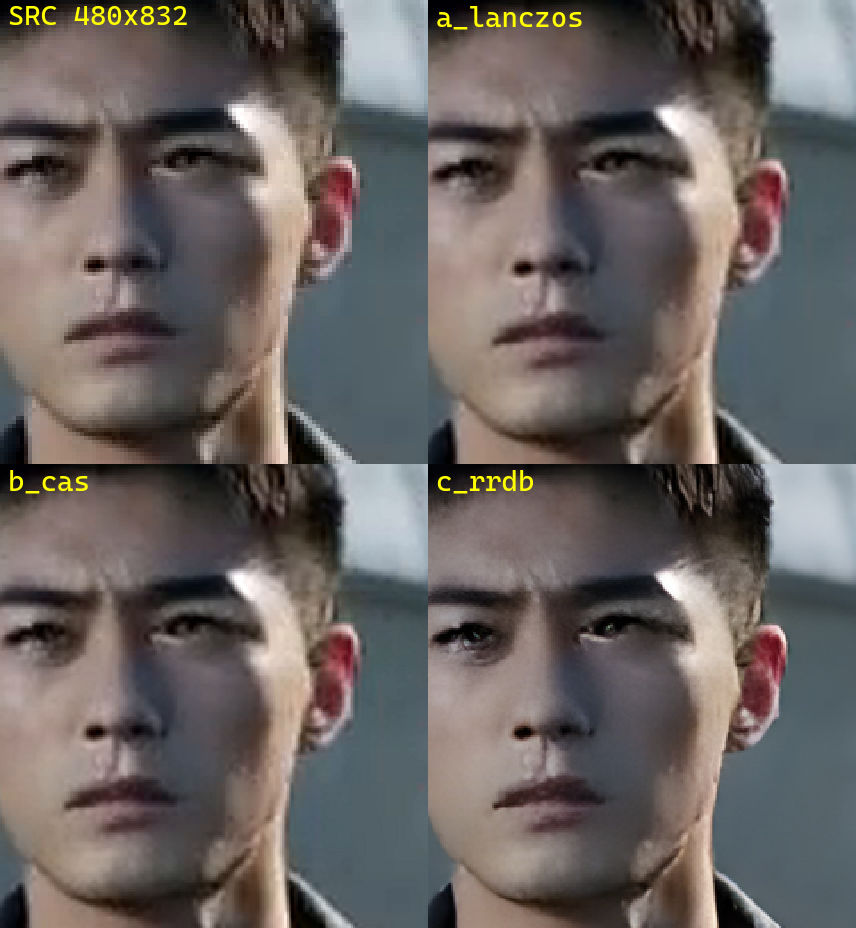

> 上图是同一帧的 1:1 对比（SRC / lanczos / lanczos+CAS / RealESRGAN）。
> 差距集中在眉毛睫毛的毛流、耳廓转折、织物颗粒三处；RealESRGAN 明显最好，且没有出塑料感。
> 代价是它慢 20~40 倍，且**逐帧独立推理、帧间不连贯**，快速运动镜头可能轻微闪烁 ——
> 要时域一致应改用视频原生超分，而不是逐帧图像超分。

### Topaz Proteus 实测

Proteus 是 Topaz 的视频原生超分模型，逐帧共享时域信息，不会像逐帧图像超分那样闪烁，
同时**不跟 H3 抢显存**（独立进程，跑完即退）。

| 场景 | 耗时 | 说明 |
|---|---|---|
| 864×480 / 120 帧 → 1728×960 | **17 s** | 命中 480×384 4× 瓦片，一帧约 0.14 s |
| 768×1344 / 107 帧 → 1536×2688 | 37 s | 面积是上一档的 2.5 倍 |
| 768×1344 / 107 帧 → 1152×2016 | 36 s | 1.5× 也走同一档 2× 瓦片再缩 |

首帧前有约 1.2 s 的模型加载，短片占比明显，长片会被摊薄。

**输出画布是精确的**：`tvai_up` 自己会把边长对齐到模型 stride（实测请求 960×1728 会出来 960×1664），
所以滤镜链后面固定接一段 `scale + pad` 把它拉回目标尺寸，避免下游拼片对不上。

**画质长这样**：同一段 864×480 成片放大到 1728×960，左边 lanczos、右边 Proteus 4：

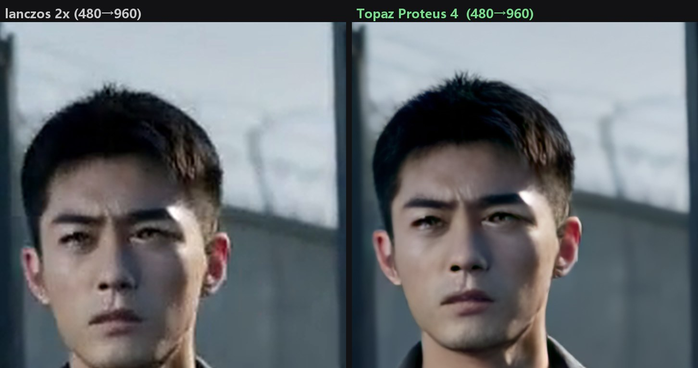

眉毛的毛流、耳廓软骨的转折、夹克织物的颗粒，都是 lanczos 里完全没有的；
脸皮也没被磨成塑料，因为默认 `blend=0.2` 把 20% 原片混了回去。

### 参数与预设

面板上有四档预设，点一下会把下面 14 个参数、参数来源开关一起改掉；之后任意手动改动会自动落回「自定义」。

| 预设 | 适用 | 关键值 |
|---|---|---|
| **AI 成片**（默认） | H3 出的片 | 画面六项全 0、分析帧数 0、混回 0.2 |
| 实拍素材 | 手机 / 相机拍的 | 分析 16 帧，其余交给模型自己估 |
| 低码率修复 | 网络抓来的糊片 | 分析 8 帧 + 去块 0.5 + 降噪/锐化/细节各 0.1 |
| 自定义 | 手调 | 按当前值跑 |

**为什么 AI 成片不开自动估计**：生成视频既没有 ISO 噪点、也没有压缩块，估计器没处下嘴，
反而会把画面压暗、对比拉硬。同一张人像跑了四组对比：

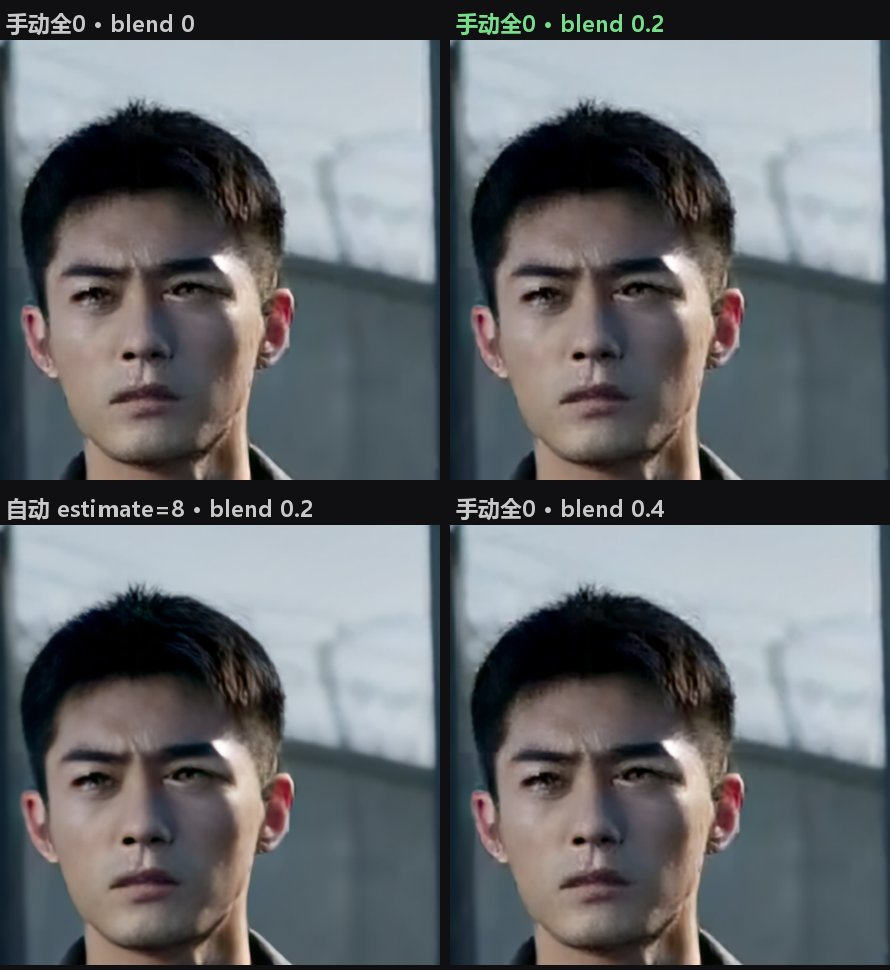

| 格位 | 组合 | 结果 |
|---|---|---|
| 左上 | 手动全 0 · blend 0 | 最锐，边缘略硬 |
| **右上** | **手动全 0 · blend 0.2** | **纹理清晰又不出白边 —— 默认就是它** |
| 左下 | 自动 `estimate=8` · blend 0.2 | 明显偏暗、对比变硬，眼窝死黑 |
| 右下 | 手动全 0 · blend 0.4 | 偏柔，细节被原片拉回去 |

差距主要在额头高光、眉骨阴影和发丝根部：自动那格把皮肤的高光压没了，
`blend` 从 0 加到 0.2 时几乎不损失细节，加到 0.4 就开始糊。所以默认落在「手动 + 六项全 0 + 混回 0.2」。

面板上还有一条**参数来源**开关，它和 `分析帧数` 是同一个参数的两种表达：

- **手动** → `estimate=0`，下面六个画面参数由滑块决定（AI 成片走这条）
- **自动估计** → `estimate>0`，模型先看 N 帧再自己定值，滑块变暗只作参考（实拍 / 低码率修复走这条）

完整参数（`tvai_up` 的全部选项）：

| 参数 | 范围 | 默认 | 作用 |
|---|---|---|---|
| 分析帧数 `estimate` | 0–40 | **0** | >0 开启自动估计，此时下面六项由模型自己定 |
| 恢复细节 `details` | -1–1 | 0 | 找回被机内降噪抹掉的纹理 |
| 降噪 `noise` | -1–1 | 0 | 去 ISO 噪点 |
| 锐化 `blur` | -1–1 | 0 | 额外锐化，画面偏软给 0.1–0.3 |
| 去光晕 `halo` | -1–1 | 0 | 压掉过度锐化留下的白边 |
| 去压缩块 `compression` | -1–1 | 0 | 去块效应，高码率成片用不到 |
| 预模糊 `preblur` | -1–1 | 0 | 抵消镜头虚；负值更适合摩尔纹/锯齿素材 |
| 混合原片 `blend` | 0–1 | **0.2** | 混回原片比例，防 AI 脸跑形 |
| 前置颗粒 `prenoise` | 0–0.1 | 0 | 处理前加颗粒喂给重建 |
| 输出颗粒 `grain` | 0–0.1 | 0 | 输出加胶片颗粒，纯观感 |
| 颗粒大小 `gsize` | 0–5 | 0 | 0 = 模型自己定 |
| 模型色彩校正 `kcolor` | 开 / 关 | 开 | 模型自带的白平衡与色彩校正 |
| 显存上限 `vram` | 0.1–1 | 0.75 | Proteus 可占用的显存比例 |
| 并发实例 `instances` | 0–3 | 1 | 多开提速，显存不够别加 |

滑块都带 tooltip 说明，命令行用 `--help` 能看到同名的长参数。

### 接入要点（踩过的坑）

Topaz 的 CLI 需要**两个**目录变量，少一个就报 `No models found in directory`，而且不会告诉你少的是哪个：

| 变量 | 指向 | 内容 |
|---|---|---|
| `TVAI_MODEL_DIR` | 模型**清单**目录 | `prob-4.json` 等几十个 JSON，几 MB |
| `TVAI_MODEL_DATA_DIR` | 模型**权重**目录 | `prob-v4-*.tz` 瓦片，几 GB |

官方安装器把两者放同一目录；但这台机器权重被挪到了 `G:\ProgramData\...`，
只设 `TVAI_MODEL_DIR` 会导致连默认的 `ahq-12` 都报 not found。
插件会自动分别探测这两类目录，也可用环境变量 `ALBER_TOPAZ_MODEL_DIR` / `ALBER_TOPAZ_WEIGHT_DIR` 覆盖，
`ALBER_TOPAZ_DIR` 覆盖安装目录。

自检：

```bash
python _tools/upscale_cli.py --check
```

它会打印安装目录、模型清单目录、权重目录、可用瓦片数，并真跑 2 帧确认 `prob-4` 能被枚举出来 ——
只查文件在不在不够，清单目录给错时文件都是好的、就是跑不起来。本机输出：

```
Topaz 安装目录 : H:\Topaz Labs LLC\Topaz Video AI
  ffmpeg       : H:\Topaz Labs LLC\Topaz Video AI\ffmpeg.exe
  模型清单目录 : C:\ProgramData\Topaz Labs LLC\Topaz Video AI\models
  权重目录     : G:\ProgramData\Topaz Labs LLC\Topaz Video AI\models
  可用瓦片     : 12 个

自检：通过 —— Topaz 可以跑 prob-4
```

**显存建议**

- 16 GB：逐段串行最稳；二采「清理显存」默认别勾（二采需要主模型留在显存里复用），真 OOM 再勾
- 24 GB：可以开 `nvidia_rtx_vsr` 或加大 `instances`
- 空间分块采样（`spatial_tiled_sampling`）默认关，长边过大或显存吃紧时再开

---

## 常见问题

**Q：装完在菜单里找不到？**
搜 `alber` 或 `导演台`，分类在 `MiniMaxH3` 下。仍找不到看控制台有没有节点注册报错。

**Q：改了 Python 要重启吗？**
改 `nodes/`、`director/`（新增路由）要重启 ComfyUI；只改 `web/js/*` 硬刷新即可。

**Q：能和原版 `ComfyUI_H3_Director_Console` 一起装吗？**
能。独立类型 ID、独立路由、独立前端扩展名，互不抢占。旧工作流里如果是上游 ID，
本机没装原版时会**自动改写**成 Alber 版（只改内存，不回写文件，控制台打印迁移条数）；
装了原版则原样放行，Alber 不越权。

**Q：出了纯黑的 mp4？**
九成是 sigmas 写成了 1000 级。H3 是 flow matching，值域 0–1，见上文「Pika 调度」。代码里已有兜底告警。

**Q：`output/性能/False.mp4` 是什么鬼？**
老工作流 `widgets_values` 错位导致的，已由导出参数自愈兜底。在参数框里确认一次导出设置后重新保存工作流即可根治。

**Q：提示词扩写一直转圈？**
检查面板里的模型配置（服务 / 地址 / 模型），点「拉模型」和「测连通」。模型没开就用「本地快拆」拆剧本，那条不依赖网络。

**Q：分段缓存越攒越大？**
FFV1 约为原始帧的 1/3。用 `/alber/director/clear_segment_cache` 定期清，或把 `缓存存储方式` 设成 `ffv1`。

**Q：日志提示 `layout self-test failed`？**
同时装了别的会改写 H3 布局的插件（如 `minimax-h3-motion-director`、旧版 Motion Context）。
禁用那个插件后重启即可。

**Q：点「✦ 二采」，面板底部红字「后端没有这条路由」？**
`director/` 加过路由就必须**重启 ComfyUI**，前端硬刷新补不上。重启后
`curl http://127.0.0.1:8188/alber/director/upscale_status` 能返回一段 JSON 就对了。
如果面板左上角一直停在「正在检测引擎…」，也是同一个原因（那个字段就是这条路由回的）。

**Q：二采报 `No models found in directory` / `model not found`？**
不是没装 Topaz，是 `TVAI_MODEL_DIR` 指错了目录 —— 要指**清单**目录而不是权重目录。
见上文[接入要点](#接入要点踩过的坑)，或直接跑 `python _tools/upscale_cli.py --check` 让它把三个路径打出来。

---

## 目录结构

```
Alber-ComfyUI-MiniMaxH3-Director/
├── __init__.py              节点注册、路由注册
├── nodes/                   节点层（薄包装）
│   ├── director_console.py  主节点 + 内置加载器
│   ├── director_refine.py   二采 / 放大
│   ├── director_selflift.py 渐进采样
│   ├── director_face_refine.py
│   ├── director_semantic_bridge.py
│   ├── director_groups.py   多组接线
│   ├── conditioning.py
│   └── console_mp4.py       MP4 直出
├── director/                执行层
│   ├── plan.py              时间轴 → 每段计划
│   ├── executor_core.py     逐段采样主循环
│   ├── gen_timeline.py      t2v / i2v 时间轴
│   ├── fl2v_timeline.py     首尾帧时间轴
│   ├── segment_continuity.py 段间连续性
│   ├── h3_motion_context.py 运动上下文
│   ├── segment_cache.py     分段磁盘缓存
│   ├── refine_sampling.py   二采采样
│   ├── h3_latent_upscale.py 3D latent 放大器（内置实现）
│   ├── spatial_tiled_sampling.py 空间分块
│   ├── script_split.py      剧本 → 镜头表
│   ├── upscale_routes.py    二采外部通道（Topaz Proteus / ffmpeg）
│   ├── http_routes.py       路由
│   └── ...
├── lib/                     通用工具（视频 / 音频 / 图像 / 模板）
├── web/js/                  前端（31 个文件，时间轴 UI + 各面板）
├── _tools/                  二采命令行、浅色主题生成与预览脚本
└── docs/images/             文档配图 19 张（架构图 / 界面截图 / 实测对比）
```

规模：后端约 31k 行 Python，前端约 34k 行 JavaScript。

---

## 许可与致谢

- 衍生自 [AIMixer/ComfyUI_MiniMaxH3_Director](https://github.com/AIMixer/ComfyUI_MiniMaxH3_Director)，Apache-2.0。
  保留原许可证与版权声明，详见 [`LICENSE`](LICENSE) 与 [`NOTICE`](NOTICE)。
- MiniMax H3 相关节点与权重归 MiniMax / Comfy-Org 所有，按各自许可使用。
- Pika H3 Flex LoRA 与其 6 步蒸馏 sigma 计划来自官方模板，请按其许可使用。
- `director/h3_latent_upscale.py` 是 [LBH-123-AI/Comfyui_Minimax_h3_latent_Upscaler](https://github.com/LBH-123-AI/Comfyui_Minimax_h3_latent_Upscaler)（Apache-2.0）的推理侧移植，
  权重需自行放入 `models/latent_upscale_models/`。
- 时间轴 UI 与执行路径来自上游；本仓库的改动集中在单节点化、分镜自动化、模板库、预览列与主题层，
  逐条记录在 `NOTICE`。
